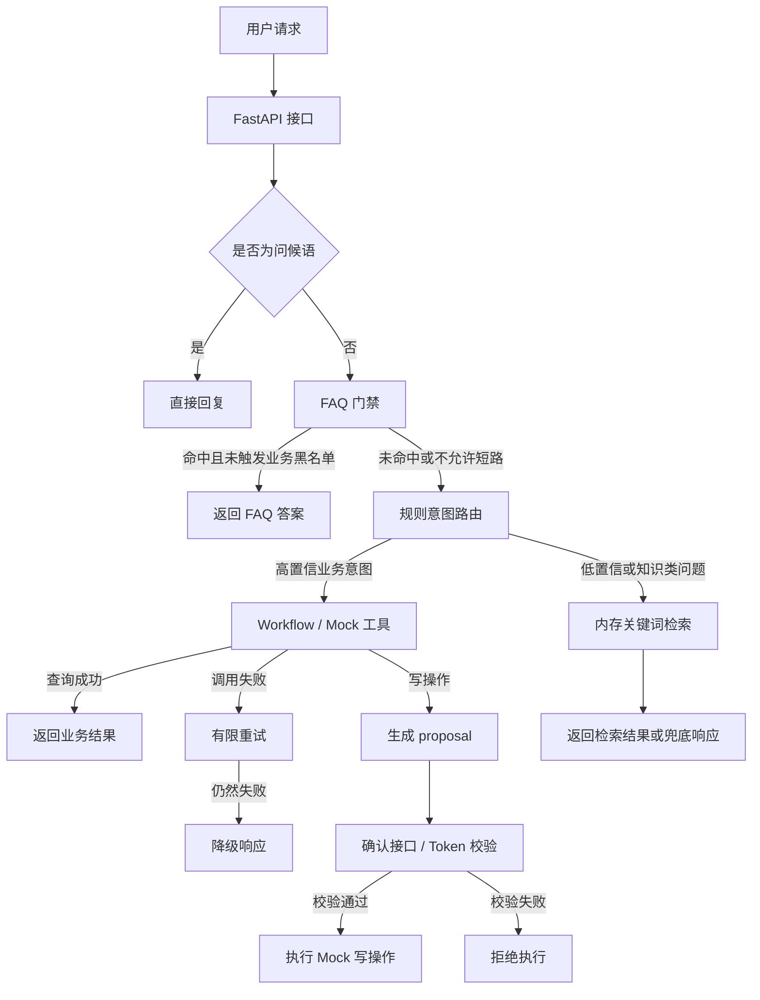

# ops-assistant-demo

一个面向虚构园区运维场景的 AI Agent 工程化 Demo，用于演示从请求入口、FAQ 门禁、意图路由，到工具调用、RAG 兜底、写操作确认和离线回归评测的核心链路。

> **项目边界**：本项目仅使用虚构场景与合成数据，不包含任何公司的生产代码、业务数据或内部系统细节。项目中的意图路由、业务工具、检索和会话存储均为轻量化模拟实现，不等同于生产系统。

## 项目亮点

- **完整处理链路**：问候语短路 → FAQ 门禁 → 意图路由 → Workflow / 工具调用或 RAG 兜底。
- **写操作确认闸**：写操作先生成 proposal，经过独立确认接口校验后才执行，不在普通问答链路中直接执行。
- **失败处理**：工具调用支持有限重试；超过重试次数后返回降级结果，避免异常直接中断请求流程。
- **离线可运行**：无需 GPU、无需外部模型 API Key；提供合成样本、离线评测入口和 pytest 测试。
- **工程边界清晰**：关键模块独立拆分，并注明 Demo 实现与可替换生产组件之间的区别。

## 架构与主流程



### 核心链路说明

1. **FAQ 门禁**：高频问题优先快速返回；业务黑名单用于避免查数、告警处置等请求被 FAQ 错误截获。
2. **意图路由**：使用规则与关键词模拟高、低置信路由。该模块可作为后续接入小模型分类器或 LoRA 分类模型的接口位置。
3. **工具调用**：通过进程内 Mock 工具模拟园区用电查询、告警查询和写操作。
4. **RAG 兜底**：使用内存关键词检索合成文档，演示检索到上下文片段后返回答案的基本流程。
5. **写操作确认**：先生成操作提议，再由独立确认接口校验 Token，通过后执行 Mock 操作。
6. **异常降级**：工具失败时进行有限重试；达到上限后返回降级信息。

## Demo 能力与生产组件映射

| 能力维度 | Demo 实现                    | 可替换的生产级组件                |
| -------- | ---------------------------- | --------------------------------- |
| FAQ 门禁 | `app/faq_gate.py` + 合成 FAQ | BM25 / 向量召回 + 业务黑名单      |
| 意图路由 | `app/intent.py` 规则与关键词 | 小模型分类器 / LoRA 意图分类      |
| 工具调用 | `app/tools.py` 进程内 Mock   | MCP 服务 / 内部 API               |
| RAG 兜底 | `app/rag.py` 内存关键词检索  | Embedding + Milvus 等向量检索组件 |
| 会话存储 | 进程内字典                   | Redis 等外部存储                  |
| 离线评测 | `data/eval/` 合成小回归集    | 更完整的业务评测集与 CI 回归流程  |

## 环境要求

- Python 3.10+
- 无需 GPU
- 无需外部模型 API Key

## 快速开始

```bash
git clone https://github.com/BoneD-Q/ops-assistant-demo.git
cd ops-assistant-demo

python -m venv .venv

# Windows
.venv\Scripts\activate

# macOS / Linux
source .venv/bin/activate

pip install -r requirements.txt
```

### 运行离线评测

```bash
python scripts/run_eval.py
```

### 运行测试

```bash
pytest -q
```

### 启动 HTTP 服务

```bash
uvicorn app.main:app --reload --port 8088
```

服务启动后，可通过 `http://127.0.0.1:8088/docs` 查看 FastAPI 自动生成的接口文档（如果项目启用了默认 OpenAPI 文档）。

## 接口示例

以下响应为**格式示例**，具体字段和值以实际运行结果为准。

### 1. FAQ / 知识类问题

```bash
curl -s -X POST http://127.0.0.1:8088/api/query \
  -H "Content-Type: application/json" \
  -d "{\"query\": \"访客登记怎么办理？\"}"
```

预期场景：命中合成 FAQ，直接返回答案，并在响应中标明实际命中的处理路径。

### 2. 查数类问题

```bash
curl -s -X POST http://127.0.0.1:8088/api/query \
  -H "Content-Type: application/json" \
  -d "{\"query\": \"A座今日用电多少？\"}"
```

预期场景：规则路由识别查数意图，调用 Mock 业务工具并返回合成用电数据。

### 3. 写操作：propose → confirm → execute

第一步，提交写操作请求，生成待确认的操作提议：

```bash
curl -s -X POST http://127.0.0.1:8088/api/query \
  -H "Content-Type: application/json" \
  -d "{\"query\": \"帮我消掉告警 ALERT-1001\"}"
```

从响应中取得 `proposal_id`，再调用确认接口：

```bash
curl -s -X POST http://127.0.0.1:8088/api/actions/confirm \
  -H "Content-Type: application/json" \
  -d "{\"proposal_id\": \"替换为实际返回的proposal_id\", \"token\": \"demo-operator\"}"
```

`demo-operator` 为演示用默认 Token；如果项目配置支持，可通过 `.env` 中的 `DEMO_CONFIRM_TOKEN` 修改。请以代码中的实际配置为准。

### 4. 模拟工具超时与降级

如果当前版本实现了 `inject` 故障注入参数，可使用以下请求验证超时处理：

```bash
curl -s -X POST http://127.0.0.1:8088/api/query \
  -H "Content-Type: application/json" \
  -d "{\"query\": \"A座今日用电多少？\", \"inject\": \"tool_timeout\"}"
```

预期场景：触发模拟工具异常，执行有限重试后返回降级响应。若代码尚未实现该故障注入参数，请先按实际接口实现调整示例。

## 评测与测试

项目提供以下离线回归场景：

- `faq_gate.json`：验证 FAQ 应命中与不应命中的问题。
- `routing_smoke.json`：验证典型问题的路由结果。
- `resilience_smoke.json`：验证工具异常、重试或降级路径。

运行命令：

```bash
python scripts/run_eval.py
pytest -q
```

建议在实际运行后补充结果表，例如：

| 检查项     | 实际结果                    |
| ---------- | --------------------------- |
| FAQ 门禁   | 运行后填写命中 / 未命中结果 |
| 意图路由   | 运行后填写通过数量          |
| 异常与降级 | 运行后填写通过数量          |
| pytest     | 运行后填写真实测试摘要      |

> 评测集为合成小样本，仅用于演示链路与回归机制，不代表生产环境效果。请勿将未实际运行的占位结果写成测试结论。

## 设计取舍与已知限制

### 为什么把 FAQ 门禁放在意图路由之前？

高频、稳定的 FAQ 可以快速返回，减少后续路由与工具调用开销。业务黑名单用于降低业务查询被 FAQ 快速路径错误截获的风险。

### 为什么使用规则路由？

Demo 目标是让面试官无需 GPU 或模型服务即可复现核心流程，因此用规则模拟意图分类。它不代表实际运行了 LoRA 模型。

### 为什么使用内存关键词检索？

避免引入向量数据库、Embedding 模型等额外依赖，同时保留基本的“检索 → 组织上下文 → 返回结果”链路。它不等同于完整的向量 RAG 系统。

### 为什么写操作要二次确认？

把写操作与普通问答链路分离：先生成提议，再由独立接口确认后执行，降低误触发风险。该机制是 Demo 中的流程演示，不代表生产级权限系统。

### 已知限制

- 意图路由为规则模拟，不包含真实 LoRA 推理。
- 业务工具为进程内 Mock，不连接真实 MCP 服务或企业内部 API。
- RAG 使用内存关键词检索，不包含真实向量化、Milvus 检索或重排模型。
- 会话与 proposal 状态保存在进程内存中，进程重启后会丢失，不适用于多实例部署。
- 演示 Token 不等同于真实身份认证与授权。
- 未实现或未保证生产级的 proposal 过期、幂等、防重放、审计日志及细粒度 RBAC。
- 合成回归集规模有限，不能据此推断生产效果。

## 目录结构

```text
app/
  __init__.py
  config.py          # 配置、黑名单、问候语、确认 Token
  degrade.py         # 重试与降级处理
  faq_gate.py        # FAQ 门禁与业务黑名单
  intent.py           # 规则路由，模拟意图分类
  main.py             # FastAPI 入口
  pipeline.py         # 主流程编排
  rag.py              # 内存关键词检索兜底
  schemas.py          # 请求与响应模型
  tools.py            # Mock 业务工具与 proposal 存储
data/
  faq.json             # 合成 FAQ
  docs.json            # 合成知识文档
  mock_biz.json        # 合成业务数据
  eval/                # 离线评测样本
scripts/
  run_eval.py          # 离线评测入口
tests/
  test_pipeline.py     # pytest 测试
requirements.txt
.env.example
README.md
```

## License

MIT，仅供作品集与面试演示。
